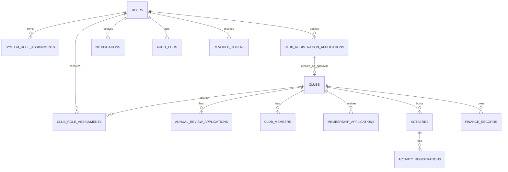

# Engineering Design V0.1——数据字典与 ER 图

> 依据现有 Alembic/SQLAlchemy Skeleton 模型整理；M02～M07 尚为契约/Schema，不表示业务端点已实现。类型中的 `PK` 为主键，`FK` 为外键；未特别说明字段均 NOT NULL。

## 1. ER 关系

## 2. 表与字段摘要

| 表 | 字段（类型；可空/默认；取值域/约束） |
|---|---|
| `users` | `id` BIGINT PK；`username` VARCHAR(64) UNIQUE；`password_hash` VARCHAR(255)；`display_name` VARCHAR(100)；`status` ENUM(NORMAL,DISABLED) 默认 NORMAL；`created_at/updated_at` DATETIME 默认 now。 |
| `system_role_assignments` | `id` BIGINT PK；`user_id` FK users；`role_code` VARCHAR(3) ∈ R01/R03/R04；`active` BOOL 默认 true；`granted_by` FK users 可空；`created_at`。UNIQUE(`user_id`,`role_code`)。 |
| `club_registration_applications` | `id`；`applicant_user_id` FK；`proposed_name` VARCHAR(150)；`description` TEXT；`advisor_contact` VARCHAR(255) 可空；`review_status` ENUM(DRAFT,PENDING,APPROVED,REJECTED,WITHDRAWN) 默认 DRAFT；`review_comment` TEXT 可空；`reviewed_by` FK 可空；`submitted_at/reviewed_at` 可空；`created_at`。 |
| `clubs` | `id`；`registration_application_id` FK UNIQUE；`name` VARCHAR(150) UNIQUE；`description` TEXT；`advisor_contact` VARCHAR(255) 可空；时间戳。 |
| `club_role_assignments` | `id`；`user_id` FK；`club_id` FK；`role_code` VARCHAR(3) 固定 R02；`active` BOOL 默认 true；`granted_by` FK 可空；`created_at`。UNIQUE(`user_id`,`club_id`,`role_code`)。 |
| `annual_review_applications` | `id`；`club_id` FK；`review_year` INT；`submitted_by` FK；`materials` TEXT；`review_status` 使用 ReviewStatus 默认 DRAFT；审核意见/人/时间可空；`created_at`。UNIQUE(`club_id`,`review_year`)。 |
| `club_members` | `id`；`club_id` FK；`user_id` FK；`position_name` VARCHAR(100) 可空；`status` ENUM(ACTIVE,EXITED) 默认 ACTIVE；`joined_at`；`exited_at` 可空。UNIQUE(`club_id`,`user_id`)。 |
| `membership_applications` | `id`；`club_id`/`applicant_user_id` FK；`application_type` ENUM(JOIN,EXIT)；`reason` TEXT 可空；`status` ENUM(PENDING,APPROVED,REJECTED,WITHDRAWN) 默认 PENDING；处理字段可空；时间戳。 |
| `activities` | `id`；`club_id`/`created_by` FK；`title` VARCHAR(200)；`description` TEXT；`location` VARCHAR(255)；`starts_at/ends_at` DATETIME；`registration_deadline` 可空；`capacity` INT 可空；`budget` DECIMAL(12,2) 默认 0；`review_status` ReviewStatus 默认 DRAFT；`execution_status` ENUM(UNPUBLISHED,REGISTRATION_OPEN,REGISTRATION_CLOSED,IN_PROGRESS,ENDED,CANCELLED) 默认 UNPUBLISHED；审核/取消/总结字段可空；时间戳。 |
| `activity_registrations` | `id`；`activity_id`/`user_id` FK；`status` ENUM(REGISTERED,CANCELLED) 默认 REGISTERED；`registered_at`；`cancelled_at` 可空。UNIQUE(`activity_id`,`user_id`)。 |
| `finance_records` | `id`；`club_id` FK；`activity_id` FK 可空；`record_type` ENUM(INCOME,EXPENSE)；`amount` DECIMAL(12,2)；`occurred_on` DATETIME；`description` VARCHAR(500)；`voucher_reference` VARCHAR(255) 可空；`status` ENUM(ACTIVE,VOIDED) 默认 ACTIVE；`created_by` FK；作废人/理由可空；`created_at`。 |
| `notifications` | `id`；`recipient_user_id` FK；`title` VARCHAR(200)；`content` TEXT；`event_type` VARCHAR(50)；`related_type` VARCHAR(50) 可空；`related_id` BIGINT 可空；`read_status` ENUM(UNREAD,READ) 默认 UNREAD；`created_at`；`read_at` 可空。 |
| `audit_logs` | `id`；`actor_user_id` FK 可空；`action/resource_type` VARCHAR(100)；`resource_id` VARCHAR(64) 可空；`detail_json` TEXT 可空；`ip_address` VARCHAR(45) 可空；`created_at`。追加写，不提供普通用户删除。 |
| `revoked_tokens` | `id`；`jti` VARCHAR(36) UNIQUE；`user_id` FK；`expires_at` DATETIME；`revoked_at` DATETIME 默认 now。 |

## 3. 半结构化字段约束

| 字段 | 规范 |
|---|---|
| `annual_review_applications.materials` | UTF-8 JSON 字符串：`{"summary":string(1..5000),"attachments":[{"name":string(1..255),"reference":string(1..255)}]}`；附件数组 0～5 项。本阶段保存课程原型引用，不做第三方文件存储或真实凭证认证。 |
| `audit_logs.detail_json` | UTF-8 JSON 字符串：`{"before":object|null,"after":object|null,"reason":string|null,"request_id":string|null}`；不得包含 `password_hash`、JWT、原始密码或附件二进制。 |
| `notifications.related_type` | 可空或 `CLUB_REGISTRATION_APPLICATION`、`ANNUAL_REVIEW_APPLICATION`、`MEMBERSHIP_APPLICATION`、`ACTIVITY`、`ACTIVITY_REGISTRATION`、`FINANCE_RECORD`。`related_id` 有值时必须同时有 `related_type`。 |

所有创建/更新由 Service 校验状态机、时间范围和资源归属；Schema 变更只能经 Alembic，新增字段或枚举需追溯至 FR/NFR 或记录 `REQUIRES_CR`。
